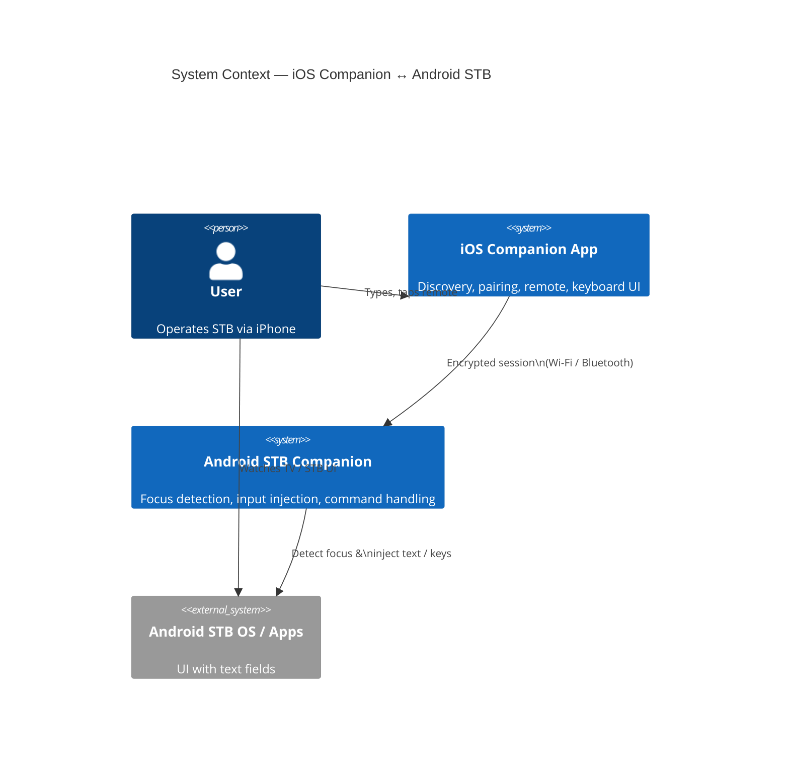
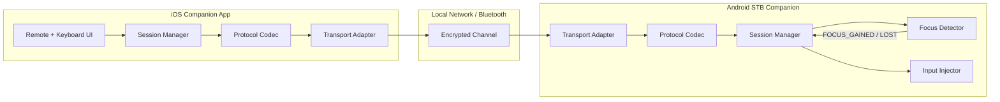
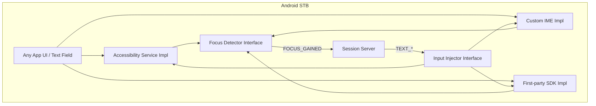
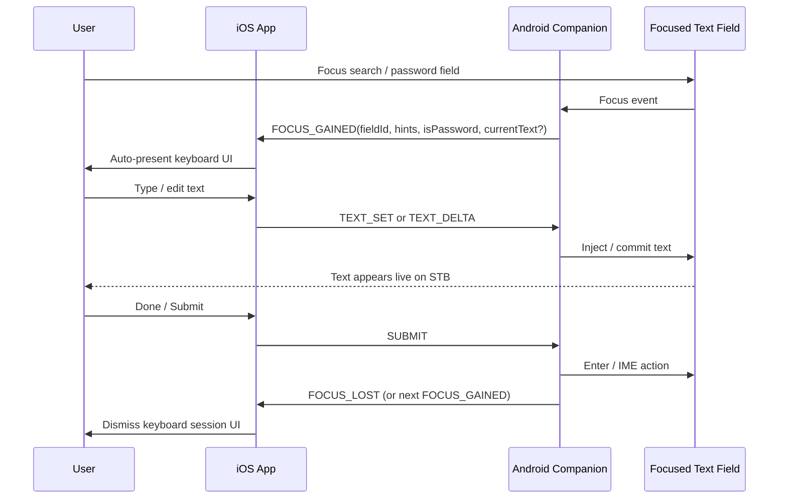
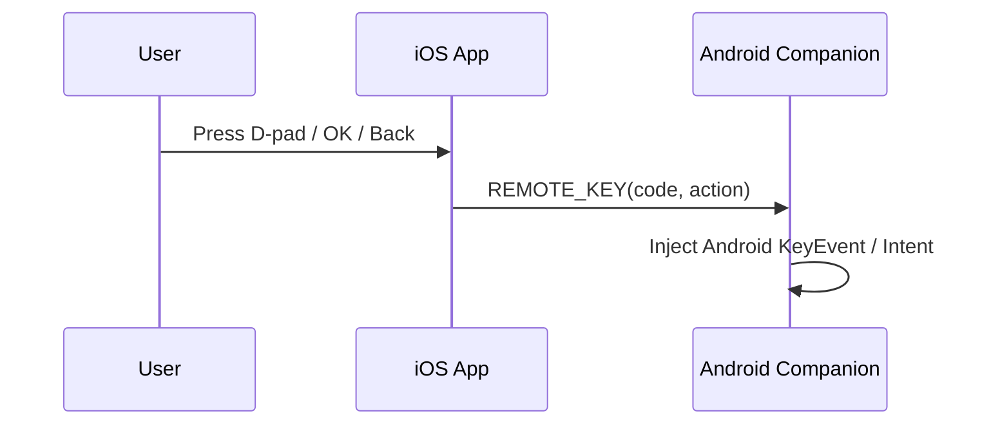
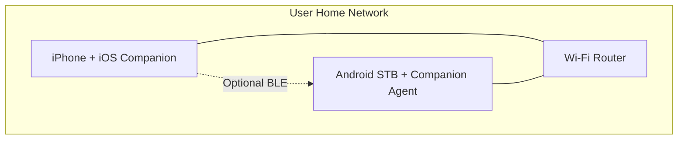

# Architecture Document
### iOS Companion App for Android STB — Pairing, Remote Control & Live Keyboard Input

| | |
|---|---|
| **Document Type** | System Architecture |
| **Related** | [Problem_Statement_iOS_STB_Keyboard.md](./Problem_Statement_iOS_STB_Keyboard.md) |
| **Version** | 0.1 (Draft) |
| **Date** | 17 July 2026 |
| **Status** | Proposed |

---

## 1. Purpose

This document defines the proposed system architecture for an iOS companion application that pairs with an Android Set-Top Box (STB) and provides:

1. Device discovery and secure pairing
2. Standard remote-control commands (navigation, playback, volume, etc.)
3. Focus-aware live keyboard input: text typed on the iPhone is streamed in near real time into the currently focused text field on the Android STB

It translates the problem statement into component boundaries, data flows, transport choices, and integration points that engineering can implement and validate against.

---

## 2. Goals and Non-Goals

### 2.1 Goals

- Low-latency text sync that feels like a hardware keyboard
- Automatic keyboard mode on iOS when an STB text field gains focus
- Reliable pairing over a home local network (primary) with optional Bluetooth
- Encrypted, authenticated channel so unpaired devices cannot inject input
- Clear separation between remote-control commands and keyboard-session traffic

### 2.2 Non-Goals (this phase)

- Full replacement of the physical STB remote
- Non-Android platforms (tvOS, Roku, Fire TV OS–specific stacks beyond generic Android)
- Voice-command STB control (distinct from iOS keyboard voice-to-text)
- Multi-user concurrent keyboard sessions on one STB

---

## 3. High-Level System Context



**Actors**

| Actor | Role |
|---|---|
| User | Pairs devices; navigates STB; types on iPhone when a field is focused |
| iOS Companion App | Client: discovery, pairing, remote UI, keyboard session UI, outbound keystrokes |
| Android STB Companion | Server/agent: accept pairing, relay focus events, inject text/keys into focused field |
| Android STB OS / Apps | Host UI where focus and text fields live |

---

## 4. Architecture Overview

The system is a **two-agent companion pair** over a shared local transport:

| Side | Role | Responsibility |
|---|---|---|
| **iOS** | Session client | Discover STB, establish secure session, send remote commands, open keyboard on focus notify, stream text deltas |
| **Android STB** | Session host | Advertise presence, accept pairing, detect text-field focus, inject received text, send focus / session lifecycle events |



---

## 5. Logical Components

### 5.1 iOS Companion App

| Component | Responsibility |
|---|---|
| **Discovery Service** | Find STBs via mDNS/Bonjour (Wi-Fi) and/or BLE advertisement |
| **Pairing Manager** | One-time trust establishment (PIN / QR / confirmation code); store pairing credentials |
| **Session Manager** | Maintain connection lifecycle, reconnect, heartbeat |
| **Remote Control Module** | Map UI buttons to remote command messages (D-pad, OK, Back, Home, Play/Pause, Volume) |
| **Keyboard Session Controller** | React to `FOCUS_GAINED`; present keyboard UI; stream text; end on Done / `FOCUS_LOST` |
| **Text Sync Engine** | Convert iOS text changes into protocol events (`TEXT_SET`, `TEXT_INSERT`, `KEY_EVENT`, `SUBMIT`) |
| **Transport Adapter** | Abstract Wi-Fi socket / BLE GATT (or dual with failover) |
| **Security Module** | TLS / Noise / app-level crypto for pairing keys and session encryption |
| **UI Layer** | Pairing screens, remote pad, automatic keyboard overlay |

### 5.2 Android STB Companion

| Component | Responsibility |
|---|---|
| **Presence Advertiser** | Publish service (`_stb-companion._tcp` or BLE UUID) with device name / capability flags |
| **Pairing Service** | Accept pairing requests; verify PIN/QR; persist trusted iOS device identity |
| **Session Server** | Accept encrypted sessions; enforce single active keyboard target |
| **Focus Detector** | Observe system-wide or in-app text focus via Accessibility Service and/or IME |
| **Input Injector** | Write text / key events into the focused field (IME commit, Accessibility actions, or Instrumentation APIs as allowed) |
| **Remote Command Handler** | Translate remote messages into Android key events / media intents |
| **Transport Adapter** | Mirror of iOS transport |
| **Security Module** | Pairing crypto, session encryption, reject untrusted peers |

### 5.3 Shared Protocol Layer

A versioned, message-based protocol (JSON over framed length-prefix, or protobuf) shared by both agents. Message families:

| Family | Examples | Direction |
|---|---|---|
| Pairing | `PAIR_REQUEST`, `PAIR_CONFIRM`, `PAIR_REJECT` | Bidirectional |
| Session | `HELLO`, `HEARTBEAT`, `DISCONNECT` | Bidirectional |
| Focus | `FOCUS_GAINED`, `FOCUS_LOST`, `FOCUS_META` | Android → iOS |
| Keyboard | `TEXT_DELTA`, `TEXT_SET`, `KEY_EVENT`, `SUBMIT`, `CANCEL` | iOS → Android |
| Remote | `REMOTE_KEY`, `MEDIA_CMD` | iOS → Android |
| Error | `ERROR`, `UNSUPPORTED` | Bidirectional |

---

## 6. Recommended Integration Model (Android)

The problem statement lists Accessibility Service vs custom IME vs SDK-in-app. Recommended phased approach:

| Phase | Model | When to use | Pros | Cons |
|---|---|---|---|---|
| **P0 (recommended start)** | **Accessibility Service** + Input injection | Need system-wide focus for third-party STB apps | Broad coverage; focus events available | OEM/policy constraints; careful UX for enabling service |
| **P1** | **Custom IME** as optional input method | Stronger typing fidelity when user selects companion IME | Natural text commit path | User must switch IME; not automatic for all apps |
| **P2** | **In-app SDK** | Team controls major STB apps | Clean APIs; fewer system permissions | Only works inside integrated apps |

**Architecture stance for v0.1:** Design the protocol around focus events + text injection so either Accessibility or IME can back the same `Focus Detector` / `Input Injector` interfaces. Prefer Accessibility for cross-app coverage unless product constrains to first-party STB UI only.



---

## 7. Transport Architecture

### 7.1 Decision Framework

| Option | Latency | Discovery | Range / Reliability | Complexity |
|---|---|---|---|---|
| **Wi-Fi (TCP / WebSocket on LAN)** | Excellent on home LAN | mDNS/Bonjour | Same network required | Medium |
| **Bluetooth LE** | Good for small payloads | BLE advertise/scan | Room-scale; no Wi-Fi needed | Higher (MTU, reconnect) |
| **Dual + failover** | Best UX | Both | Best coverage | Highest |

**Proposed default for v0.1:** **Wi-Fi primary** (TCP or WebSocket over TLS on local network), with architecture hooks for BLE as secondary.

### 7.2 Transport Adapter Interface

Both platforms expose the same logical interface:

- `discover()`
- `connect(peerId)`
- `send(frame)`
- `onReceive(frame)`
- `disconnect()`
- `getLinkQuality()` (optional; for failover)

Failover policy (if dual transport enabled): prefer Wi-Fi; fall back to BLE on Wi-Fi loss; migrate keyboard session with a short buffer / resync of current field text.

---

## 8. Security Architecture

| Concern | Approach |
|---|---|
| Device trust | One-time pairing with short PIN shown on STB (or QR encoding session secret) |
| Identity | Persist pairing key / certificate per device pair; rotate on re-pair |
| Confidentiality | TLS 1.3 for Wi-Fi; encrypted BLE characteristic or Noise_XX over BLE |
| Integrity | Authenticated encryption; reject unsigned/unauthenticated frames |
| Authorization | Only paired peers may send `TEXT_*` / `REMOTE_KEY` |
| Sensitive fields | Optional flag from Android (`isPassword`) so iOS can use secure text entry and avoid logging |
| Threat | Unpaired LAN device must not inject text or remote keys |

Pairing state machine (conceptual):

```
UNPAIRED → PAIRING → PAIRED → SESSION_ACTIVE → SESSION_IDLE
                ↘ REJECTED / EXPIRED
```

---

## 9. Core Flows

### 9.1 Discovery and Pairing

```mermaid
sequenceDiagram
    participant User
    participant iOS as iOS App
    participant STB as Android STB Companion

    User->>iOS: Open Pair New Device
    iOS->>STB: Discover (mDNS / BLE)
    STB-->>iOS: Advertise (name, capabilities)
    User->>iOS: Select STB
    iOS->>STB: PAIR_REQUEST
    STB-->>User: Show PIN on TV
    User->>iOS: Enter PIN
    iOS->>STB: PAIR_CONFIRM(PIN proof)
    STB-->>iOS: PAIR_OK + session credentials
    Note over iOS,STB: Persist trust; ready for sessions
```

### 9.2 Focus → Keyboard Session → Live Typing



### 9.3 Remote Control (non-keyboard)



---

## 10. Keyboard Sync Model

To feel “live,” prefer **full-field sync with sequence numbers** over raw per-key HID emulation when using predictive text / autocorrect on iOS.

| Strategy | Description | Use when |
|---|---|---|
| **A. Full text snapshot** | iOS sends entire field string + cursor on each change | Autocorrect / dictation / paste |
| **B. Incremental deltas** | Insert/delete ranges with base version | Optimized for fast typing |
| **C. Key events** | Down/up for Enter, Backspace, arrows | Navigation inside field / submit |

**Recommended:** Hybrid — default to **A** for correctness with iOS keyboard features; optionally use **B** for bandwidth; always support **C** for control keys.

```
TEXT_SET {
  sessionId,
  seq,
  text,
  cursorStart,
  cursorEnd
}
```

Android applies only if `seq` is monotonic for the active `sessionId` tied to the current `fieldId`.

---

## 11. Session and Concurrency Rules

- One active keyboard session per STB at a time
- `FOCUS_GAINED` for a new field ends or migrates the previous session
- Connection drop mid-entry: STB keeps current field text; iOS shows reconnect UI; on resume, Android may send `FOCUS_META` with current text for resync
- Multiple paired STBs: iOS selects an **active target**; keyboard events go only to that target
- Heartbeat interval (e.g. 2–5s); miss N heartbeats → mark link degraded / disconnect

---

## 12. Deployment Topology



No cloud dependency required for core pairing and typing in v0.1. Cloud may be added later for account linking or remote-not-at-home scenarios (explicitly out of scope now).

---

## 13. Technology Sketch (illustrative)

| Layer | iOS (candidate) | Android STB (candidate) |
|---|---|---|
| Language / UI | Swift / SwiftUI | Kotlin |
| Local discovery | Bonjour (`NetService`) | NSD / JmDNS |
| Wi-Fi transport | Network.framework / WebSocket | ServerSocket / Ktor / OkHttp WebSocket |
| BLE (optional) | CoreBluetooth | Android BLE GATT server |
| Security | CryptoKit + TLS | Android Keystore + TLS |
| Focus / inject | N/A | AccessibilityService and/or IME |
| Protocol | Shared schema (protobuf or JSON Schema) | Same |

Exact libraries are implementation choices; interfaces above are the architectural contract.

---

## 14. Quality Attributes

| Attribute | Target (draft) | Notes |
|---|---|---|
| Typing latency | ≤ 50–100 ms one-way on LAN for typical keystroke/update | Stakeholder to confirm |
| Focus-to-keyboard UI | ≤ 300 ms after focus event received | Includes UI presentation |
| Reliability | Graceful reconnect; no duplicate inject on replay with seq checks | |
| Security | Paired-only injection; encrypted transport | |
| Battery | Idle session uses heartbeats sparingly; keyboard mode may raise rate | |

---

## 15. Mapping to Success Criteria

| Success criterion (problem statement) | Architectural support |
|---|---|
| Near-real-time text on STB | Hybrid text sync + low-latency LAN transport + seq-ordered apply |
| Auto keyboard on focus | `FOCUS_GAINED` push event → Keyboard Session Controller |
| Reliable on home Wi-Fi/BT | Transport adapter + heartbeat + reconnect + optional failover |
| Faster than D-pad OSK | Full iOS keyboard (autocorrect, dictation) via `TEXT_SET` model |

---

## 16. Risks and Mitigations

| Risk | Impact | Mitigation |
|---|---|---|
| OEM locks Accessibility / injection | Feature limited to first-party apps | Fall back to SDK/IME; document supported devices |
| High LAN latency / Wi-Fi congestion | Laggy typing | Prefer full snapshots less frequently; measure RTT; BLE fallback |
| Autocorrect desync | Wrong text on STB | Prefer `TEXT_SET` over raw keys |
| Password leakage in logs | Security | `isPassword` flag; redact logs; secure text field on iOS |
| Split focus / multiple fields | Wrong injection target | Single-focus invariant; bind session to `fieldId` |

---

## 17. Open Architectural Decisions

1. **Transport:** Wi-Fi-only vs dual Wi-Fi + BLE with failover  
2. **Android integration:** Accessibility-first vs IME-first vs first-party SDK-only  
3. **Protocol encoding:** JSON vs protobuf  
4. **Latency SLO:** Exact ms budget for “live” feel  
5. **STB scope:** Generic Android TV / AOSP STB vs specific OEM SKUs  
6. **Companion ownership:** Whether Android agent is a new app, system service, or embedded SDK  

---

## 18. Suggested Delivery Phases

| Phase | Scope |
|---|---|
| **M0** | Protocol draft, pairing over Wi-Fi, remote keys only |
| **M1** | Focus events + `TEXT_SET` keyboard session (Accessibility or first-party SDK) |
| **M2** | Password fields, reconnect/resync, hardening |
| **M3** | BLE transport and/or IME path; polish latency |

---

## 19. Document History

| Version | Date | Notes |
|---|---|---|
| 0.1 | 17 July 2026 | Initial architecture from problem statement |
